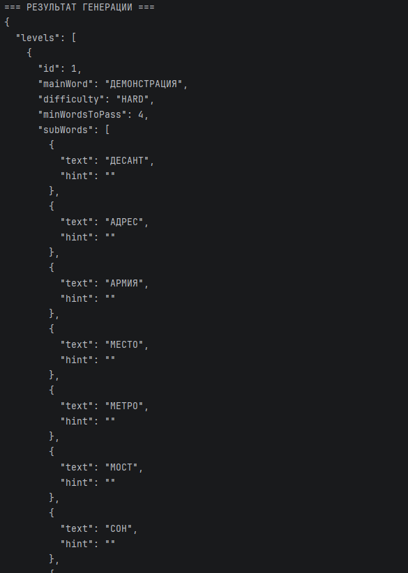
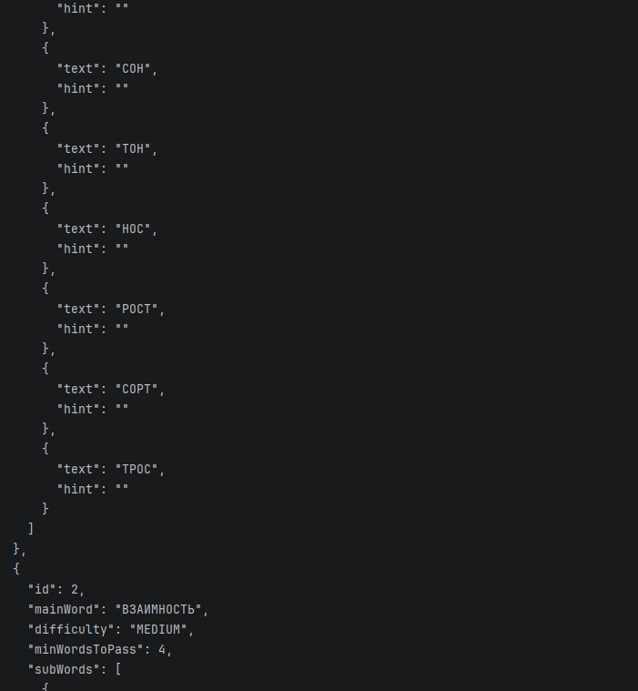
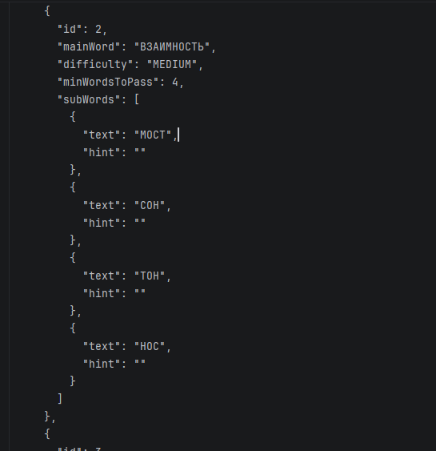
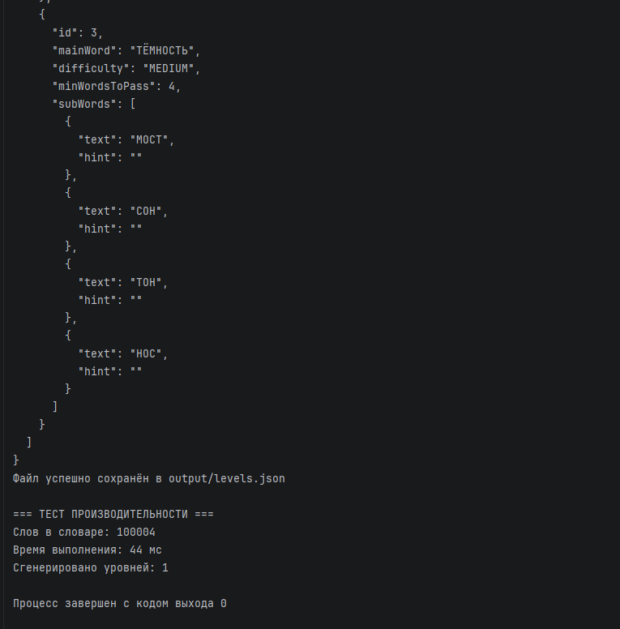
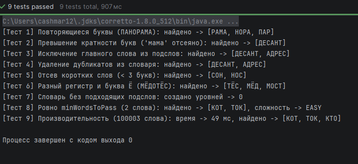

# WordsFromWord

## Overview / Description
**WordsFromWord — Level Generator** is a Java 8 console application designed to automatically generate game levels for the word puzzle *"Words from Word"* (also known as *"Anagrams"* or *"Wordscapes"*).

The program reads a word dictionary, a list of target main words, and difficulty rules from JSON files, filters valid sub-words based on strict letter frequency validation, and exports structured game levels to `output/levels.json`.
<!-- Краткое описание проекта: что это за программа и для какой игры/задачи она создана -->

## Key Features
- **Automated Level Creation:** The program automatically selects all relevant sub-words from the dictionary for each given main word, eliminating the need to manually construct levels.
- **Strict Letter Frequency Validation:** Ensures that each letter in a sub-word does not appear more times than it exists in the main word.
- **Data Cleaning & Normalization:** Removes extra spaces, converts all words to uppercase (respecting Russian locale settings and preserving the letter 'Ё'), and removes duplicates.
- **Rule-Based Filtering:** Excludes sub-words shorter than `minSubWordLength`, excludes the main word itself, and skips levels that do not meet `minWordsToPass`.
- **Dynamic Difficulty Assignment:** Automatically classifies each generated level as `EASY`, `MEDIUM`, or `HARD` based on configurable word length and sub-word count thresholds.
- **JSON Serialization:** Reads input data from JSON files and exports clean, formatted level data into `output/levels.json`.

<!-- Список основных возможностей и правил работы программы -->

## Tech Stack & Requirements
To build and run this project, you need the following tools and libraries:
- **Java Development Kit (JDK):** Java 8 (version 1.8)
- **Build Tool:** Apache Maven (or the included Maven Wrapper `./mvnw`)
- **IDE:** IntelliJ IDEA (recommended)
- **Libraries & Dependencies:**
    - `com.google.code.gson:gson:2.10.1` — for JSON parsing and serialization
    - `junit:junit:4.13.2` — for unit testing
<!-- Необходимые инструменты: версия Java, система сборки (Maven), библиотеки и IDE -->

## Project Structure
The screenshot below illustrates the complete project architecture in IntelliJ IDEA, including Maven dependencies (`Gson 2.10.1`, `JUnit 4.13.2`), input/output JSON directories, and separated `model`, `service`, and `util` packages:

<!-- Дерево папок и описание назначения каждого пакета/файла -->

## Installation & How to Run
1. Clone or download the repository to your computer:
   ```bash
   git clone https://github.com/demfi604/WordsFromWord
   ```
2. Open the `WordsFromWord` folder in **IntelliJ IDEA**.
3. Wait a few seconds for **Maven** to download dependencies (`Gson` and `JUnit`), or press `Ctrl + Shift + O` to reload `pom.xml`.
4. Open `src/main/java/org/example/Main.java` and click the green **Run** button (`Shift + F10`). The generated levels will appear in the console and be saved to `output/levels.json`.
5. To execute unit tests, open `src/test/java/LevelGeneratorTest.java` and click **Run**.

## Input & Output Examples

### Input Files (`input/`)


**1. `input/config.json` (Generation & Difficulty Rules):**
```json
{
  "minSubWordLength": 3,
  "minWordsToPass": 4,
  "difficultyThresholds": {
    "easyMaxMainWordLength": 7,
    "mediumMaxMainWordLength": 10,
    "easyMaxSubWords": 15,
    "mediumMaxSubWords": 30
  }
}
```

**2. `input/dictionary.json` (Source Dictionary):**
```json
[
  "десант", "АДРЕС", "армия", "место", "метро",
  "десант", "ад", "ДЕМОНСТРАЦИЯ", "мама",
  "тётя", "ёлка", "мост", "сон", "тон", "нос", "рост", "сорт", "трос"
]
```

**3. `input/main_words.json` (Target Main Words):**
```json
[
  "ДЕМОНСТРАЦИЯ",
  "ВЗАИМНОСТЬ",
  "ТЁМНОСТЬ"
]
```

### Output File (`output/levels.json`)
```json
{
  "levels": [
    {
      "id": 1,
      "mainWord": "ДЕМОНСТРАЦИЯ",
      "difficulty": "HARD",
      "minWordsToPass": 4,
      "subWords": [
        { "text": "ДЕСАНТ", "hint": "" },
        { "text": "АДРЕС", "hint": "" },
        { "text": "АРМИЯ", "hint": "" },
        { "text": "МЕСТО", "hint": "" },
        { "text": "МЕТРО", "hint": "" },
        { "text": "МОСТ", "hint": "" },
        { "text": "СОН", "hint": "" },
        { "text": "ТОН", "hint": "" },
        { "text": "НОС", "hint": "" },
        { "text": "РОСТ", "hint": "" },
        { "text": "СОРТ", "hint": "" },
        { "text": "ТРОС", "hint": "" }
      ]
    }
  ]
}
```
<!-- Примеры входных данных (JSON) и результата работы программы -->

## Screenshots
### 1. Generation Results & Performance Benchmark (`Main.java`)
The screenshots below demonstrate the complete JSON output generated for the main words (`ДЕМОНСТРАЦИЯ`, `ВЗАИМНОСТЬ`, `ТЁМНОСТЬ`), automatic saving to `output/levels.json`, and the performance benchmark on 100,004 dictionary words (**44 ms**):









### 2. Functional & Edge-Case Tests (`[Test 1]` – `[Test 9]`)
Execution log verifying all 9 test scenarios: repeated letters, letter frequency limits, exclusion of the main word, duplicate removal, minimum word length filtering, Russian `Ё` handling, empty results, pass thresholds, and large dictionary performance:


<!-- Скриншоты запуска программы в консоли и прохождения тестов -->

## Known Limitations
- **Russian Letter `Ё` vs `Е`:** The generator treats `Ё` and `Е` as distinct characters, so words written with `Е` in the dictionary will not match `Ё` in a main word.
- **Full Dictionary Scan per Main Word (`O(N × M)` Complexity):** For each main word, the algorithm scans the entire dictionary from scratch and allocates a new `HashMap` for every candidate word. While processing 100,000 dictionary words for a single main word takes around 30–44 ms, generating levels for 5,000 main words would take over a minute.
- **Empty Hints:** The `hint` field for each generated sub-word defaults to an empty string (`""`), as the input dictionary does not contain word definitions.
<!-- Слабые места и ограничения алгоритма (например, буква Ё/Е, зависимость от словаря) -->

## Authors / Team
Authors: Мс.Борик и Мс.Каштан
(Кадоркин и Фролов)

Team: "Ответственные за павидло в пряниках"
<!-- Имена и роли участников команды -->
